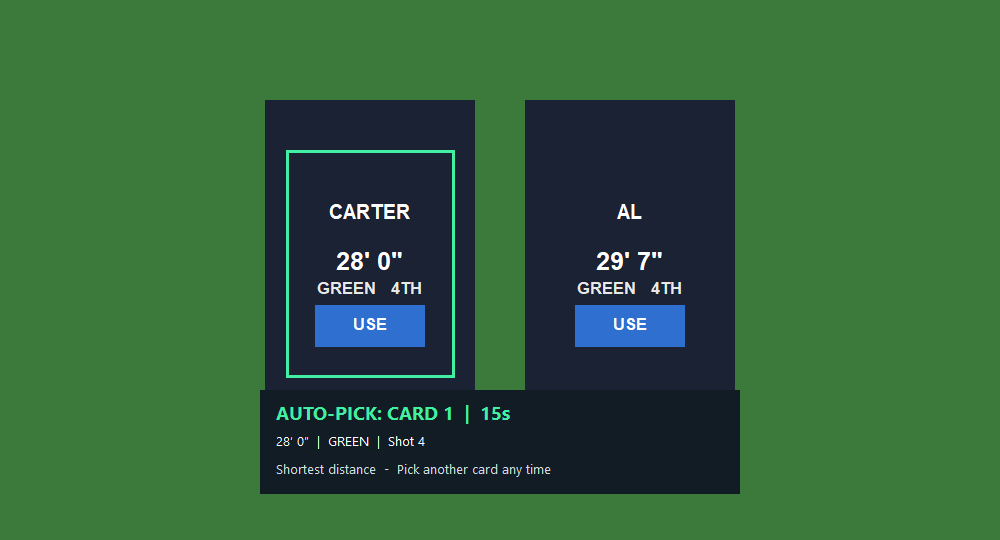
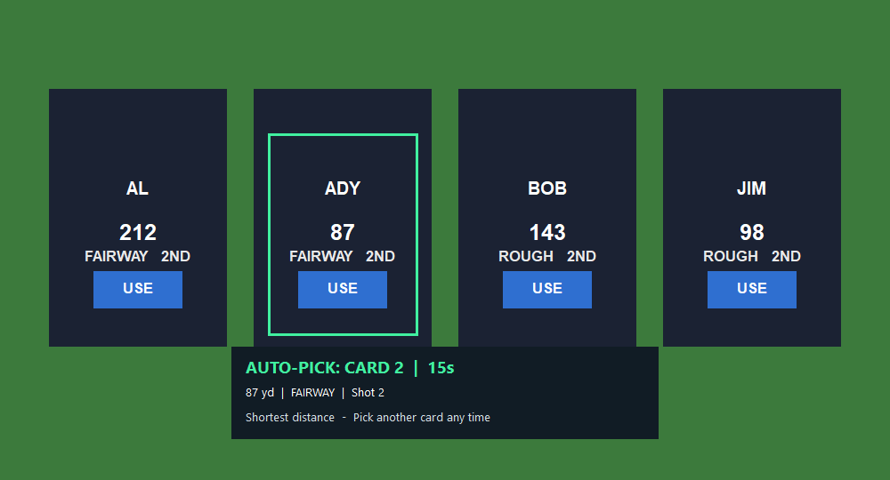

# Scramble chosen-card preview — v5.1.2 development

The green frame identifies the card leading the same vote used by Auto-Pick. The panel shows card number, parsed distance, lie, shot number, selection reason and time remaining. It updates as reads vote. Players can still choose another USE button.

These images are **actual captures of BA Remapper running on Windows over drawn GSPro-style test cards**, not photographs or live GSPro gameplay. Original sim photographs were not present in tracked repository history. The fixture's name/distance/lie/USE proportions were already based on the field measurements recorded in the source/tests.

## Two cards: feet and inches on the green

Both balls have the same shot number and are on the green, so the shorter distance wins. The panel uses the parsed value, including prime feet/inch marks, rather than repeating OCR mistakes such as `291 71'`.

## Four cards: yards

All four cards have the same shot number and are off the green; card 2 is closest. The frame surrounds that card's contents and leaves its USE button readable. The explanation also supports Fewest strokes and Green preferred when those rules decide the pick.

## Behavior and evidence

- The existing **Show chosen card highlight and countdown** preference controls all preview visuals; its saved setting is preserved.
- The preview follows the highest-card-count vote leader and existing latest-read tie breaker, rather than blindly displaying the newest read's winner. Unreadable, partial or stale geometry shows no chosen frame.
- Frame positions come from the same physical desktop coordinates as the GSPro client and detected USE labels. Moving/resizing the game hides the old frame until the next valid read. Negative desktop origins are retained; no monitor-1 assumption.
- The frame uses measured text proportions and neighbor spacing. It is not exact card-edge detection and never drives a click.
- Overlay windows are layered, transparent, no-activate, and owned by the game. They keep focus and let clicks reach the underlying game, including along the outline itself.
- Windows capture exclusion is verified. If true exclusion is unavailable, the OCR lock hides overlays and flushes composition before reading. The light visual timer performs no OCR or key sending.
- Focus loss, minimize, missing cards, disabled preferences, cooldown, reset, and stale/stalled state hide the relevant visuals. The two-miss cancellation rule and the actual pick remain unchanged.
- No new default physical-button mapping, Pick Now, or Skip This Pick action was added in this focused feature. Those remain possible future controls.

[Windows validation run 40614795112](https://github.com/DiyGolfGuy/BA-Remapper/actions/runs/40614795112) passed on source `5a5d90d5684a2fcaf28c3abb13211597ee5d7cc7`: real en-US OCR with two/four-card previews visible, click-through, focus, vote changes, partial-read handling, cleanup, geometry at negative origins/2x size, all existing parser/hotkey/UI checks, Unicode x64 compilation, and an actual installer upgrade preserving settings/profiles. The two images above come from that run. Later changes to this checkpoint add documentation/images and strengthen test assertions; application source is unchanged.

The app stays on `dev/v5.1.2` in draft PR #3. **Not merged or publicly released; the website update remains v5.1.1.** Live GSPro appearance, the physical box and a physical 1–4-screen setup still need owner acceptance.

References consulted: [GSPro UI guide](https://gspro.gitbook.io/gspro-knowledge-base/in-game-information/in-game-user-interface), [GSPro changelog](https://gsprogolf.com/change-log.html), [AutoHotkey v1 Gui](https://github.com/AutoHotkey/AutoHotkeyDocs/blob/v1/docs/lib/Gui.htm), [Microsoft SetWindowDisplayAffinity](https://learn.microsoft.com/en-us/windows/win32/api/winuser/nf-winuser-setwindowdisplayaffinity).
